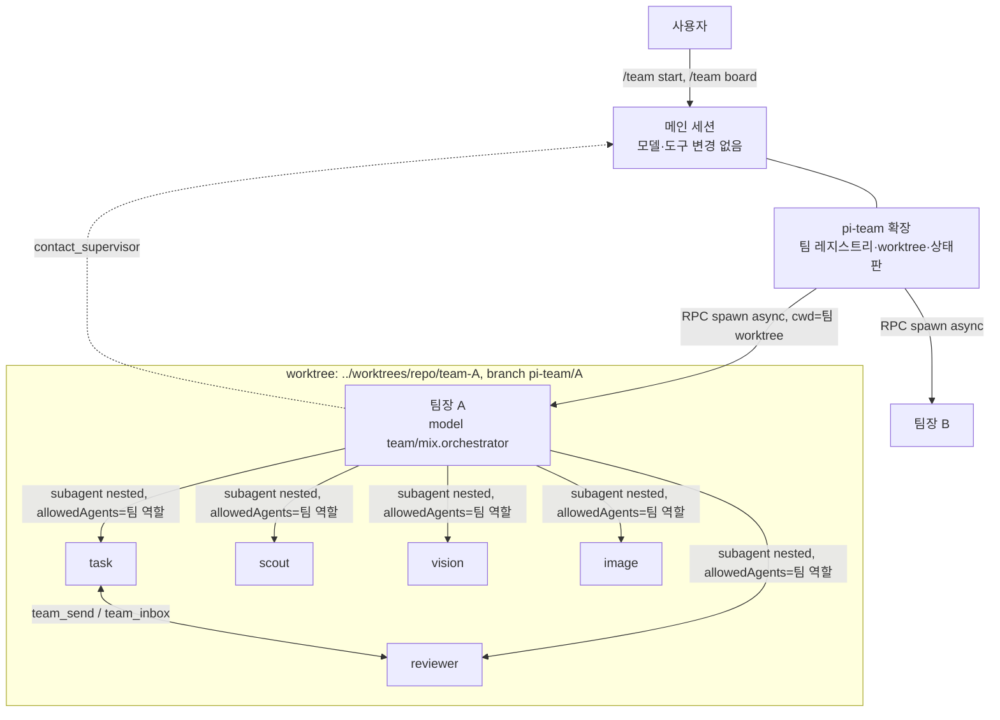

# pi-team 설계안 v2: 서브에이전트 팀, 역할별 모델 preset, 팀 worktree, HAM식 상태판

- 상태: v2 설계 초안입니다(2026-11-25). 구현 전 사용자 확인을 기다리고 있습니다. v1(pi-mesh)을 대체합니다.
- 대상: Mac Studio의 pi 1.6.0과 pi-subagents 0.90.0(설치함). 로그인된 provider는 anthropic과 openai-codex(OAuth)입니다.

## 0. v1에서 바뀐 점

| 항목 | v1 | v2 |
|---|---|---|
| 실행 단위 | 부모의 `subagent` 호출 1회 | **팀**: 팀장(orchestrator) 1명과 역할별 팀원으로 구성합니다. 메인 세션은 그대로 둡니다. |
| 트리거 | 상시 로드 | `/team` 명령으로만 시작합니다. 메인 모델에는 팀 도구를 노출하지 않습니다. |
| 모델 | 역할별 체인(`model-sets.json`) | **preset**: 역할 슬롯(orchestrator, task, scout, reviewer, vision, image 등)마다 후보 체인을 둡니다. 각 슬롯은 virtual model로 구현합니다. |
| worktree | 자식별 선택 | **팀마다 git worktree 1개**를 두고 팀장과 팀원이 공유합니다. |
| 실패 후 대체 | 부작용이 생긴 뒤에는 다른 모델로 resume | resume으로는 모델을 바꿀 수 없음을 확인해(P0) 이 방식을 삭제했습니다. 이제 보존한 뒤 보고만 합니다. |
| 상태판 | mesh 단위 | 팀, 역할, 실제 모델, 현재 활동, 메시지를 한 화면에서 봅니다. |

## 1. P0 검증 결과 (2026-11-25, Mac Studio, 실제 실행)

| # | 질문 | 결과 | 근거 |
|---|---|---|---|
| Q1 | 자식 확장의 `ctx.sessionManager.getSessionId()`가 자식 자신의 값인가 | **예.** 부모와 자식 A, B의 ID·세션 파일이 모두 다릅니다. 이번 실행에서 병렬 자식은 별도 PID로 돌았습니다. | `pi-mesh-p0/out/whoami-*.json` |
| Q2 | 자식 안에서 `pi.sendMessage(…, {deliverAs:"steer"})`를 호출하면 자식 세션에 들어가는가 | **예.** 자식 A 세션에는 `STEERED MA`만, 자식 B 세션에는 `MB`만 기록됐습니다. 두 자식 모두 주입된 메시지를 인지했습니다. | 각 자식 `session.jsonl` |
| Q3 | resume할 때 모델을 바꿀 수 있는가 | **아니요.** 실행기가 model override를 거부하고, 저장된 모델을 재사용합니다. | pi-subagents `subagent-executor.js:1660-1683, 2060-2074`, `rpc.js:427-447` |
| Q4 | 자식에 등록한 virtual model이 preflight와 충돌하는가 | **충돌하지 않습니다.** agent의 `model: mesh/probe`가 자식 프로세스 안에서 `route()`(reason `user`, `continuation`)를 거쳐 `gpt-6-luna`로 전송됐습니다. | `out/route.log`, 자식 세션의 provider 기록 |

## 2. 구조



- **pi-team 확장(메인 프로세스):**
  - 두는 것: `/team` 명령, 팀 레지스트리, worktree 생성·보존, 상태판 widget과 overlay, preset 해석. 역할별 agent 정의는 preset에서 생성합니다.
  - 두지 않는 것: 메인 모델이 쓰는 도구. 메인의 모델, thinking, 활성 도구는 바꾸지 않습니다.
- **pi-team-child 확장:**
  - 주입 방식: `registerRequiredChildExtensions`를 쓰며, 팀장과 팀원에 nested·resume을 포함해 유지됩니다(VERIFIED 문서).
  - 내용: preset virtual model 등록, `team_*` 메시지 도구, 자기 등록, 실패 분류와 cooldown 기록.
- **팀장:**
  - pi-subagents 중첩 위임을 씁니다. 기본 깊이가 2라서 메인 → 팀장 → 팀원 구조에 충분합니다.
  - `allowNestedSubagents: true`로 위임을 허용하고, `allowedAgents`로 이 팀의 역할 agent만 실행할 수 있게 합니다.
  - 팀원은 위임할 수 없는 leaf입니다.
- **메인과 팀의 관계:**
  - 팀은 async로 실행되므로 메인 대화는 계속 쓸 수 있습니다.
  - 팀장 → 메인: `contact_supervisor`.
  - 메인 → 팀장: `/team send` → RPC `steer`.

## 3. 트리거: 필요할 때만

- 시작 명령은 `/team start <preset> [--name N] [--repo PATH] -- <목표>` 하나뿐입니다. 메인 모델에는 `team_*` 도구가 등록되지 않으므로 모델이 스스로 팀을 만들 수 없습니다.
- 팀이 없을 때 확장이 하는 일:
  - `/team` 명령과 virtual model 목록 등록만 합니다. virtual model은 `/model` 목록에 보이지만 선택하지 않으면 영향이 없습니다.
  - 그 밖의 비용은 0입니다. 디스크 감시나 polling을 하지 않습니다.
- 그 밖의 명령:
  - `/team board`: 상태판 overlay
  - `/team inbox [team] [member]`: 메시지 수신함
  - `/team send <team> <msg>`: 팀장에게 메시지 보내기
  - `/team stop <team>`: 팀 중지
  - `/team close <team>`: worktree 정리
  - `/team preset list|show|use`: preset 관리
- 함께 설치된 pi-subagents의 `subagents_enable` loader는 메인 모델에 노출됩니다. 메인에서 이것도 막으려면 `subagents.toolActivation`을 조정해야 하는데, 이것은 선택 사항입니다(§9 결정 D6).

## 4. preset과 역할 슬롯

```jsonc
// ~/.pi/agent/teams/presets.json (전역). 프로젝트 .pi/teams/presets.json은 같은 이름을 통째로 대체
{
  "version": 1,
  "default": "mix",
  "presets": {
    "mix": {
      "roles": {
        "orchestrator": { "models": ["anthropic/claude-opus-5-5:high", "openai-codex/gpt-6.2-sol:xhigh"] },
        "task":         { "models": ["openai-codex/gpt-6.2-sol:medium", "anthropic/claude-opus-5-5:high"], "max": 3 },
        "scout":        { "models": ["openai-codex/gpt-6-luna:high", "openai-codex/gpt-6.2-sol:medium"], "readOnly": true },
        "reviewer":     { "models": ["openai-codex/gpt-6.2-sol:high", "anthropic/claude-opus-5-5:high"], "readOnly": true },
        "vision":       { "models": ["openai-codex/gpt-6.2-sol:high", "anthropic/claude-opus-5-5:high"], "readOnly": true },
        "image":        { "models": ["openai-codex/gpt-6.2-sol:medium"], "tools": ["codex_generate_image"],
                          "extensions": ["npm:pi-codex-image-gen@0.3.2"] }
      },
      "limits": { "maxMembers": 6, "maxParallel": 4 }
    },
    "codex": { "roles": { "orchestrator": { "models": ["openai-codex/gpt-6.2-astra:high"] }, "task": { "models": ["openai-codex/gpt-6.2-sol:high"] } } }
  },
  "fallback": { "cooldownMs": { "quota": 3600000, "rate_limit": 300000, "overloaded": 120000 } }
}
```

- **역할 슬롯:** `orchestrator`, `task`, `scout`, `reviewer`, `vision`, `image`를 기본으로 두고, 사용자가 역할을 더 추가할 수 있습니다(예: `planner`, `security`). 슬롯마다 다음을 정합니다.
  - `models`: 후보를 순서대로 적습니다.
  - `tools` / `extensions`: 그 역할에만 로드할 도구와 확장입니다.
  - `readOnly`: write·edit를 막습니다.
  - `max`: 한 팀에서 그 역할로 띄울 수 있는 인원입니다.
  - `prompt`: 역할 지침이며 선택 항목입니다.
- **역할 agent 생성:** preset을 적용하면 확장이 `~/.pi/agent/agents/pi-team/<preset>/<role>.md`를 생성합니다. frontmatter의 `model`은 virtual model `team/<preset>.<role>`입니다. 그래서 팀장이 `subagent`로 역할을 지정하기만 하면 preset 모델이 적용됩니다. 팀장은 실행별 `model` 인자를 쓰지 말라는 지시와 `modelScope`로 제한합니다.
- **모델 선택(virtual model `route`):**
  - `reason: user` / `continuation`일 때는 후보 가운데 인증되어 있고 cooldown 중이 아닌 첫 모델을 고릅니다. cooldown 상태는 `~/.pi/agent/teams/cooldown.json`에 저장하며 호스트 전체가 공유합니다.
  - `reason: retry`일 때(pi 자동 재시도: overload, 일시적 429)는 실패한 모델을 건너뛰고 다음 후보를 고릅니다. 대화 컨텍스트는 그대로 유지됩니다.
- **quota·billing 소진:** pi가 재시도하지 않는 오류입니다. 자식 확장이 최종 오류를 분류해 cooldown을 기록하고, 팀장에게 `{role, model, class, sideEffects}`를 보고합니다.
  - `sideEffects=false`면 팀장이 같은 역할을 다시 실행합니다. 이때 route가 cooldown 모델을 건너뛰므로 자동으로 다음 후보가 쓰입니다.
  - `sideEffects=true`면 다시 실행하지 않고 부분 diff를 보존한 뒤 보고합니다.
- **vision과 image의 구분:**
  - `vision`: 이미지를 입력으로 받는 chat 모델과 `read`의 조합입니다. 이미지는 팀 worktree나 보존 경로의 절대 경로로 전달합니다.
  - `image`: chat 모델과 생성 도구의 조합입니다. pi 내장 이미지 생성은 OpenRouter 전용이므로, 현재 로그인 상태로는 `pi-codex-image-gen`(Apache-2.0, 월 4.4천 다운로드)을 image 역할에만 로드해야 합니다. 이 패키지는 openai-codex OAuth fallback을 쓰지만 동작은 아직 검증하지 않았습니다. 결과물은 `save` 경로를 팀 worktree의 `artifacts/`로 지정합니다. 패키지의 artifact 도구는 OS 임시 디렉터리를 쓰므로 사용하지 않습니다.
- **명령:** `/team preset use <name>`은 앞으로 시작할 팀의 기본값만 바꿉니다. 이미 실행 중인 팀은 시작할 때의 preset snapshot을 그대로 씁니다.

## 5. 팀 worktree

- `/team start`는 cwd의 git 저장소에서 `git worktree add -b pi-team/<team> <repoParent>/worktrees/<repo>/team-<team> HEAD`를 실행합니다. 위치는 pi-subagents의 native 위치 규칙에 맞춥니다.
  - 미커밋 변경이 있으면 기본값으로는 시작하지 않습니다. `--from-dirty`를 주면 경고한 뒤 HEAD 기준으로 시작합니다.
  - git 저장소가 아니면 worktree 없이 cwd를 공유하며, 쓰기 역할은 1명으로 제한합니다.
- 팀장은 worktree를 `cwd`로 받아 async로 실행됩니다. 팀원은 `cwd`를 생략해 팀장의 cwd를 상속하고, `worktree: false`로 실행합니다. 팀원별 관리형 worktree는 쓰지 않습니다.
- **팀 종료:** 팀장이 끝나도 남은 팀원 run이 없는지 RPC status로 확인한 뒤 `done`으로 표시합니다. worktree와 branch는 보존합니다.
- **병합:** 자동으로 하지 않습니다. 상태판에 `git diff --stat main...pi-team/<team>`을 보여 주고 사용자가 판단합니다.
- **정리:** `/team close`는 branch가 이미 병합됐거나 사용자가 확인했을 때만 `git worktree remove`를 실행합니다. 정리 전에 결과 요약과 ledger를 `~/.pi/agent/teams/archive/<team>/`로 옮깁니다.
- 동시에 여러 팀을 돌리면 팀마다 별도 worktree를 씁니다. 같은 저장소의 다른 팀과 파일이 겹치는지는 상태판의 충돌 후보로 표시합니다.

## 6. 팀 안 메시징

v1 §4를 유지하고 범위를 팀 단위로 바꿉니다.

- **도구:** `team_peers`, `team_send(to, body, subject?, replyTo?, refs?)`, `team_inbox`, `team_wait(≤120s)`.
- **주소:** 같은 팀의 `<role>-<n>`, `lead`, `*`. 다른 팀에는 보낼 수 없습니다(§9 결정 D5).
- **전송:** 파일 mailbox `~/.pi/agent/teams/<team>/inbox/<member>/`를 씁니다. 수신 쪽 자식 확장이 `steer`로 주입합니다(P0 Q2로 검증).
- **메시지 종류:** HAM과 달리 `fyi`/`action`이 없습니다. `replyTo`로 스레드만 연결합니다. 상태는 sent → delivered → replied/closed, 또는 undelivered입니다.
- **안전장치:** 답장 체인 hop 5회, 자식당 분당 20건, 본문 4 KiB 상한, 전원이 대기 상태일 때의 교착 해제를 둡니다.
- **자기 등록:** 자식 확장이 `session_start`에서 `{sessionId, sessionFile, agent, cwd, pid}`를 `members/<sessionId>.json`에 기록합니다. pi-team은 RPC status의 `sessionFile`과 run ID를 대조해 member key를 확정합니다.

## 7. 상태판 (HAM식)

**widget(팀이 있을 때만, 한 줄):** `teams: A ▶ 4/5 running ✉3 · B ✓ done (diff +120 -14)`

**`/team board` overlay:**

```
TEAM A  preset mix  ▶ running 12m  worktree ../worktrees/kidori/team-A  branch pi-team/A  diff +84 -12
ROLE          MEMBER        MODEL (actual)                   STATE    NOW                         ✉ S/R  TOKENS
orchestrator  lead          claude-opus-5-5:high             running  subagent(task-2)            4/3    41k
task          task-1        gpt-6.2-sol:medium               running  edit src/scene.ts           2/1    88k
task          task-2        gpt-6.2-sol ⇢ claude-opus-5-5    running  bash npm test               1/2    23k
scout         scout-1       gpt-6-luna:high                  done     —                           1/1    12k
reviewer      reviewer-1    gpt-6.2-sol:high                 waiting  team_wait(task-1)           0/2     5k
image         image-1       gpt-6.2-sol:medium               failed   quota → cooldown 58m        0/1     2k
────────────────────────────────────────────────────────────────────────────────────────────────────
last: task-1 → reviewer-1 "API 스키마 변경 완료, 검토 요청" (delivered 14:02)
```

- **데이터 출처:**
  - 팀 레지스트리: 역할, preset, worktree.
  - pi-subagents RPC `status.asyncSnapshot`: 실제 모델, `currentTool`, `activityState`, 토큰, 중첩 children.
  - 팀 ledger: 메시지 집계.
  - `pi -p`에서는 `jobsChanged` 이벤트가 오지 않으므로, overlay가 열려 있는 동안 2초마다 polling합니다.
- **키 조작:** `↑↓`로 팀원을 고르고 `Enter`로 transcript를 엽니다. `i`는 수신함, `s`는 팀장에게 메시지 보내기, `x`는 팀원 중지입니다.

## 8. 결과 취합

- 팀장이 끝나면 pi-team이 `~/.pi/agent/teams/<team>/summary.md`를 만듭니다. 내용은 다음과 같습니다.
  - 역할별 결과와 실제 모델
  - 메시지 스레드의 결론, 답장을 받지 못한 질문
  - 변경 파일과 diff stat
  - fallback·cooldown 이력
  - 충돌 후보
- 메인 세션에는 `nextTurn` 메시지로 3 KiB 이하 요약 카드를 넣습니다. 메인 모델을 바로 실행하지는 않습니다.
- 사용량은 역할별로 합산해 상태판과 요약에 표시합니다. 이미지 생성 사용량은 「미확인」으로 표시합니다.

## 9. 사용자 확인이 필요한 결정

| # | 결정 | 권고 |
|---|---|---|
| D1 | 트리거 방식 | `/team` 명령으로만 시작하고, 메인 모델이 팀을 시작하지 못하게 합니다. |
| D2 | 조율자 | 팀장 서브에이전트(orchestrator 역할)가 조율하고 메인은 그대로 둡니다. |
| D3 | worktree 수명 | 팀마다 HEAD에서 branch `pi-team/<team>`을 만들고, 끝나도 보존합니다. 병합은 하지 않고 사용자가 판단합니다. |
| D4 | 기본 preset `mix`의 역할·모델 | §4 표 그대로 사용합니다. |
| D5 | 다른 팀과의 메시지 | 허용하지 않습니다. |
| D6 | 메인의 `subagents_enable` loader | 그대로 둡니다. pi-subagents를 메인에서 직접 쓸 수 있는 상태를 유지합니다. |
| D7 | 이미지 생성 패키지 | `pi-codex-image-gen@0.3.2`를 image 역할에만 로드합니다. 검증에 실패하면 image 역할을 비활성화합니다. |
| D8 | 저장소 | `~/workspace/development/pi-team`에 로컬 git 저장소를 만들고 원격은 두지 않습니다. pi에는 `pi install <path>`로 연결합니다. |

## 10. 구현 단계와 수용 기준

| 단계 | 내용 | 수용 기준 |
|---|---|---|
| I1 | preset·virtual model·역할 agent 생성, `/team preset` | 역할 agent를 실행하면 preset 후보 1순위 모델로 응답합니다. cooldown을 주입하면 2순위로 바뀌고 상태판에 `⇢`가 표시됩니다. |
| I2 | `/team start`·worktree·팀장 async 실행·중첩 팀원 | 팀장이 task와 reviewer를 띄워 같은 worktree에서 작업하고 끝납니다. worktree와 branch가 보존되고, 메인 모델은 바뀌지 않습니다. |
| I3 | 팀 메시징 | task ↔ reviewer 사이에 질문과 답장이 오가고, 상태가 replied로 기록됩니다. 종료된 팀원에게 보낸 메시지는 undelivered가 됩니다. |
| I4 | 상태판·수신함·취합 | overlay가 역할, 실제 모델, 현재 도구, 메시지 수를 2초 안에 갱신합니다. `summary.md`와 메인 요약 카드가 생성됩니다. |
| I5 | vision·image 역할 | vision이 worktree의 PNG를 읽고 설명합니다. image가 `artifacts/`에 PNG를 만듭니다(OAuth 경로 검증). |
| I6 | 정리·실패 경로 | `/team stop`, `/team close`, quota 분류, 부작용이 생긴 뒤 실패했을 때의 보존을 faux provider로 시험합니다. |

## 11. 남은 위험

- pi-subagents는 아직 0.x라 API가 바뀔 수 있습니다. 시작할 때 `ping.capabilities`로 확인하고, 지원 버전을 `0.90.x`로 고정합니다.
- 팀장이 지시를 어기고 `subagent`에 `model`을 직접 넘길 수 있습니다. `modelScope`의 allow 목록을 `team/*`로 제한해 막습니다. 이 제한은 I1에서 검증합니다.
- 중첩된 팀원이 팀장 종료 뒤에도 살아 있을 수 있습니다. 그래서 팀 종료는 RPC status 기준으로만 판정합니다.
- 이미지 생성 패키지는 제3자 코드이고 OAuth 경로가 검증되지 않았습니다. image 역할에만 격리해 로드합니다.
