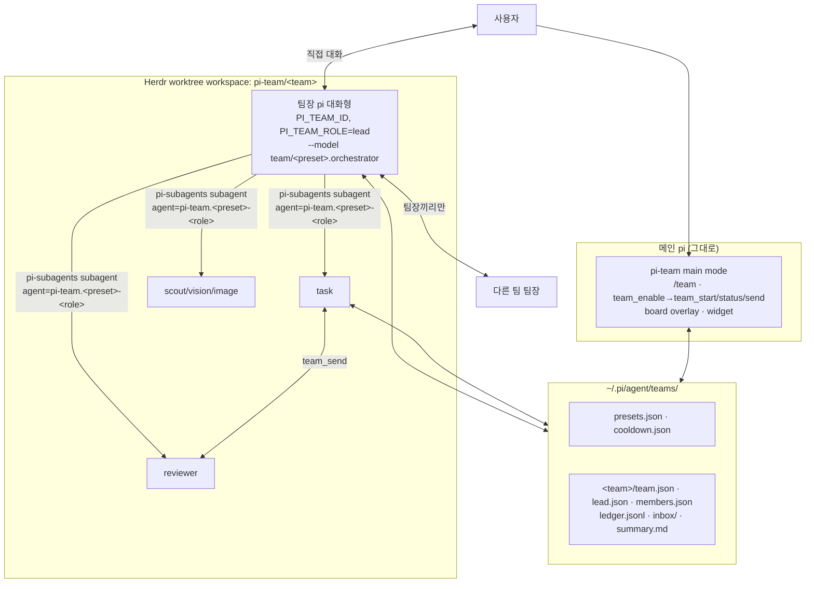

# pi-team 설계 v3 (확정)

- 확정일: 2026-11-25. 사용자 결정 D1~D8과 E1~E4, 추가 요청(overlay TUI)을 반영했습니다. v2 원문은 `DESIGN-v2.md`에 있습니다.
- 대상: pi 1.6.0과 pi-subagents 0.90.x. Mac Studio에서 anthropic과 openai-codex OAuth로 로그인되어 있습니다.

## 1. 확정 결정

| # | 결정 |
|---|---|
| D1 | 시작은 `/team` 명령으로 합니다. **사용자가 대화에서 명시적으로 요청한 경우** 메인 모델도 팀 도구로 시작할 수 있습니다. |
| D2/E1 | 팀장은 **독립된 대화형 pi 세션**입니다. Herdr 안이면 팀마다 `herdr worktree create`로 worktree workspace를 만들고 그 pane에서 실행합니다. 사용자는 팀장과 직접 대화합니다. |
| D3 | 팀 worktree는 HEAD(또는 `--base`)에서 branch `pi-team/<team>`으로 만듭니다. 끝나도 보존하고, 병합은 사용자가 결정합니다. `/team close`로 정리합니다. |
| D4 | 기본 preset `mix`는 v2 §4 표대로 둡니다(아래 §4). |
| D5 | 팀 사이 메시지는 **팀장끼리만** 주고받습니다. 팀원은 자기 팀 안에서만 보냅니다. |
| D6 | 메인의 pi-subagents(`subagents_enable`)는 그대로 둡니다. |
| D7 | image 역할에만 `pi-codex-image-gen@0.3.2`를 로드합니다. 메인에는 설치하지 않습니다. 검증에 실패하면 image 역할을 비활성화합니다. |
| D8 | 코드는 `~/workspace/development/pi-team`의 로컬 git 저장소에 둡니다. Mac Studio에서 `pi install <path>`로 연결합니다. |
| E2 | idle 상태의 팀장이 다른 팀장의 메시지를 받으면 바로 턴을 시작합니다. 작업 중이면 steer로 넣습니다. |
| E3 | 메인 모델도 팀장에게 메시지를 보낼 수 있습니다(`team_send`). 사용자는 `/team send`로 보냅니다. |
| E4 | Herdr 밖에서는 git worktree만 만들고 팀장 실행 명령을 안내합니다. 어느 pi 세션에서든 `/team board` overlay로 모든 팀, worktree, 팀 안의 동작을 볼 수 있습니다. |

## 2. P0 검증 결과 (실행 확인)

- 자식 세션 ID와 세션 파일은 자식마다 고유합니다.
- 자식 안에서 `pi.sendMessage(steer)`를 호출하면 그 자식 세션에만 들어갑니다.
- 자식에 등록한 virtual model은 자식 프로세스 안에서 `route()`를 거쳐 실제 모델로 전송됩니다.
- resume할 때 모델을 바꿀 수는 **없습니다**.
- 근거: `~/.cache/agent-work/.omp-9615d25fee/pi-mesh-p0/out/`

## 3. 구조



하나의 패키지(`pi-team`)가 세 모드로 동작합니다.

| 모드 | 판별 기준 | 역할 |
|---|---|---|
| main | `PI_TEAM_ROLE` 없음 | `/team` 명령, `team_enable` loader, board overlay·widget, 팀 생성·정리, 메인 모드(`main.ts`) |
| lead | `PI_TEAM_ROLE=lead`, `PI_TEAM_ID=<team>` | heartbeat, 팀원 snapshot, 팀장용 메시지 도구, 필수 child 확장 등록, `subagent` 호출 검사, 팀 보고 |
| member | 필수 child 확장(`child.ts`) | virtual model 등록, 팀 메시지 도구, 자기 등록, 부작용 추적, 오류 분류와 cooldown 기록 |

- virtual model(`team/<preset>.<role>`)은 **모든 모드에서** 등록합니다. preflight 단계와 자식 프로세스 모두 이 모델을 찾을 수 있어야 하기 때문입니다. 단, main 모드는 `team/<preset>.orchestrator`를 등록하지 않습니다. 메인 모델 후보로 골라지면 사고 수준이 무시되고, 캐시 데우기가 꺼지며, 일반 서브에이전트가 그 모델을 찾지 못해 실패하기 때문입니다.
- pi-subagents의 foreground 자식은 부모의 확장을 불러오지 않습니다. 그래서 메인 모드의 역할 agent는 `subagentOnlyExtensions`에 `models.ts`를 넣어 자식에도 virtual model을 등록합니다.

## 4. preset과 역할

- **층 구조:** `presets.default.json`(저장소) → `~/.pi/agent/teams/presets.json`(호스트) → `<repo>/.pi/teams/presets.json`(프로젝트) 순서로 겹칩니다. 파일이 없으면 그 층은 비어 있는 것으로 봅니다(더 이상 기본값을 파일로 쓰지 않습니다).
- **v2 형식(`"version": 2`):** `models`는 모델 별칭(`"opus": "anthropic/claude-opus-5-5"`), `presets`는 `{ extends, abstract, description, slots, roles }`입니다.
  - 역할의 `models`는 문자열 하나나 배열이고, 항목은 `@slot`, `별칭:수준`, `provider/id:수준` 가운데 하나입니다. 슬롯은 후보 목록으로 펼치고, 중복은 앞의 것만 남깁니다.
  - 해석은 `extends` 사슬의 조상부터 차례로 슬롯을 덮어쓰고, 역할은 속성 단위로 합칩니다. 역할 값 `null`은 그 역할을 없앱니다. `abstract` preset(`base`)은 목록에 나오지 않습니다.
  - 층 사이에서는 `models`를 별칭 단위로, 같은 이름의 preset을 슬롯·역할 단위로 합칩니다.
- **예전 형식:** `version`이 없는 파일의 preset은 같은 이름의 아래 층 preset을 통째로 대체합니다.
- **오류 격리:** preset마다 따로 해석·검증합니다. 실패한 preset은 목록에서 빠지고 이유가 `/team preset show`와 `Unknown preset` 오류에 나옵니다. 파일 자체를 읽지 못하면(JSON 오류, 잘못된 `models`) 전체가 실패합니다.
- **팀 캐프처:** 팀을 만들 때 해석된(평면) preset 전체를 `teams/<id>/preset.json`에 저장합니다. 팀장과 구성원은 이 파일을 읽으므로, 실행 중 preset을 바꿔도 팀은 영향을 받지 않습니다.
- **기본 preset:** `mix`, `advanced`, `claude`, `claude-advanced`, `codex`, `codex-advanced`. 역할과 슬롯의 연결은 다음과 같습니다. orchestrator는 `@lead`, task·frontend-dev·mobile-dev·game-dev·cloud-dev·qa-tester는 `@build`, scout는 `@scout`, vision은 `@vision`, tech-writer는 `@write`, image는 `@image`, 나머지 설계·검토 역할은 `@deep`입니다. `claude` 계열은 Codex OAuth가 필요한 image 역할을 뺍니다. `mix` 계열은 task만 `@task` 슬롯(sol:high → sonnet:high)을 써서 다른 구현 역할보다 effort를 높입니다.
- **로그인 확인:** 팀 시작과 메인 모드는 첫 후보에 로그인되어 있지 않은 역할을 알립니다(`authGaps`).

  | 역할 | `mix` 후보 체인 | 속성 |
  |---|---|---|
  | orchestrator | `anthropic/claude-opus-5-5:high` → `openai-codex/gpt-6.2-sol:xhigh` | 팀장 세션 자체 모델 |
  | task | `openai-codex/gpt-6.2-sol:medium` → `anthropic/claude-opus-5-5:high` | max 3 |
  | scout | `openai-codex/gpt-6-luna:high` → `openai-codex/gpt-6.2-sol:medium` | readOnly |
  | reviewer | `openai-codex/gpt-6.2-sol:high` → `anthropic/claude-opus-5-5:high` | readOnly |
  | vision | `openai-codex/gpt-6.2-sol:high` → `anthropic/claude-opus-5-5:high` | readOnly, 이미지 경로를 `read` |
  | image | `openai-codex/gpt-6.2-sol:medium` | `codex_generate_image` 도구, 결과는 `<worktree>/artifacts/` |

- **역할 추가:** 사용자가 역할을 자유롭게 추가할 수 있습니다. 역할 속성은 `models`, `description`, `skills`, `mcp`, `tools`, `extensions`, `readOnly`, `max`, `prompt`입니다.
  - `description`은 agent의 description과 팀장 프롬프트의 역할 목록에 들어갑니다. 팀장은 이 설명을 보고 팀원을 고릅니다.
  - `skills`는 agent frontmatter `skills:`로 들어가 그 팀원에게만 해당 스킬을 줍니다.
  - `mcp`는 팀원 전용 MCP 서버입니다(`blender`, `rea`). pi-subagents는 `mcp:` 선택을 부모 세션이 이미 연결한 서버에서만 찾으므로, pi 내장 MCP 대신 팀원 전용 확장(`blender-mcp/extension.ts`, `subagentOnlyExtensions`)이 MCP 클라이언트가 되어 서버 도구를 일반 도구(`mcp__blender__<tool>`)로 등록합니다. 확장은 `blender-mcp/launch.py`를 실행하고, 런처는 빈 포트에 헤드리스 Blender(`harness.py`)와 같은 판의 mcp-for-blender 서버를 띄웁니다. 포그라운드와 백그라운드 팀원 모두에서 동작합니다.
  - 서버는 공용 클라이언트 `mcp/client.ts`(`LazyMcp`)가 관리합니다. 첫 도구 호출 때 서버를 별도 프로세스 그룹(`detached`)으로 시작하고, 팀원 세션이 끝나면 그룹 전체에 SIGTERM을 보내고 5초 뒤 SIGKILL을 보냅니다. `idleMs`를 주면 그 시간 동안 호출이 없을 때 서버를 끄고 다음 호출 때 다시 띄우며, 재시작 사실을 도구 결과에 알립니다. 도구 정의는 `~/.cache/pi-team/mcp/<이름>-tools.json`에 캐시해, 서버를 띄우기 전에도 도구를 등록합니다.
  - Blender는 지연 시작만 하고 유휴 종료는 하지 않습니다. 저장하지 않은 장면이 사라지기 때문입니다.
  - `rea`(`rea-mcp/extension.ts`)는 REA 도구 260여 개를 하나씩 등록하지 않고 중계 도구 `rea_tools`(검색), `rea_tool_schema`, `rea_call`만 등록합니다. 10분(`PI_TEAM_REA_IDLE_MINUTES`) 동안 호출이 없으면 종료하고, 호출 제한 시간은 1시간입니다. Ghidra 경로(`GHIDRA_INSTALL_DIR`)와 JDK 25 이상(`JAVA_HOME`)을 자동으로 찾아 넘깁니다. Ghidra JVM은 별도 프로세스 그룹이지만, REA가 SIGTERM을 받거나 stdin이 닫히면 함께 종료합니다.
- **역할 agent 생성:** 확장이 `~/.pi/agent/agents/pi-team/<preset>/<role>.md`를 생성합니다. frontmatter는 `package: pi-team`, `name: <preset>-<role>`, `model: team/<preset>.<role>`이고, readOnly 역할은 `excludeTools: write, edit`로 둡니다. orchestrator는 agent 파일을 만들지 않습니다.
- **virtual model 라우팅:**
  - `reason` 값이 `continuation`이나 `direct`(압축 등)이고 직전 응답 모델이 후보에 있으면 그 모델을 유지합니다. 같은 턴 안에서 모델을 바꾸면 prompt cache를 잃기 때문입니다.
  - 그 밖의 `user`와 `continuation`은 인증이 있고 cooldown 중이 아닌 첫 후보를 고릅니다.
  - `retry`면 실패한 모델을 건너뜁니다.
  - 후보가 모두 막혔으면 cooldown이 가장 먼저 끝나는 후보를 고르고 경고를 남깁니다.
- **실패 분류(member):** `agent_end`/`agent_settled`의 최종 `stopReason:"error"`와 `errorMessage`를 다음 네 분류로 나눕니다.
  - `quota`: `insufficient_quota`, `usage limit`, `billing`, `quota`
  - `rate_limit`: 429, `rate limit`
  - `overloaded`: 529, 503, `overloaded`
  - `auth`: 401, 403
  - 분류가 정해지면 `cooldown.json`에 기록하고 ledger에 `fallback` 이벤트를 남깁니다.
  - `sideEffects`는 write·edit·bash를 한 번이라도 실행했으면 true입니다.
- **팀장 프롬프트 규칙:**
  - 실패한 팀원의 `sideEffects`가 false면 같은 역할을 다시 실행합니다. route가 cooldown 모델을 건너뛰므로 자동으로 다음 후보가 쓰입니다.
  - true면 다시 실행하지 않고 사용자에게 보고합니다.
- **`subagent` 호출 강제(lead):** `tool_call` hook으로 `subagent` 호출을 검사해 두 경우를 막습니다.
  - `model` 인자가 있는 호출
  - `pi-team.<현재 preset>-*`가 아닌 agent를 지정한 호출

### 임시 라우팅 조정(`overrides.ts`, `routing.ts`)

- `/team effort`와 `/team model`은 역할별 임시 조정을 `teams/<id>/overrides.json`(팀) 또는 `teams/main-overrides/<세션 ID>.json`(메인 모드)에 저장합니다. preset 파일은 바꾸지 않으므로 팀을 닫거나 메인 모드를 끄면 사라집니다. 메인 모드 파일은 14일 동안 바뀌지 않으면 지웁니다.
- router는 요청마다 자기 범위의 파일을 읽습니다. 팀장과 구성원은 `PI_TEAM_ID`, 메인 모드에서 위임한 자식은 메인 세션이 설정한 `PI_TEAM_MAIN_KEY`로 범위를 정합니다. 그래서 이미 실행 중인 구성원도 다음 요청부터 바뀐 값을 씁니다.
- 모델 조정은 후보 맨 앞에 붙고, 같은 모델의 기존 후보는 빠집니다. effort 조정은 고른 후보의 수준을 대신합니다.
- 팀장은 처음 시작할 때 첫 후보의 effort로 thinking 수준을 맞추고, 그 값을 세션 항목 `pi-team-lead-level`에 남깁니다(재개도 `startup`으로 시작하므로 덮어쓰지 않기 위해서입니다). 사용자가 `shift+tab`이나 `/team effort orchestrator`로 다른 수준을 고르면 router가 그 값을 따릅니다. 우선순위는 팀장 세션의 선택, 파일 조정, 후보의 수준 순입니다.
- `/team routes`는 대화형 화면에서 `routes-view.ts` overlay를 엽니다. 대상은 팀장 세션이면 자기 팀, 메인 세션이면 메인 모드 preset과 실행 중인 팀들입니다(`tab`으로 전환). 행마다 `routeRows()`가 계산한 NEXT(고른 후보와 효과 수준), FALLBACK(나머지 후보와 로그인·cooldown 상태), RUNNING(살아 있는 구성원의 실제 모델·수준)을 보여 줍니다. `←→`는 `levels` 순서로 한 단계씩 바꾸고, `m`은 overlay를 닫고 pi 선택창으로 로그인된 모델(역할 후보와 별칭)을 고른 뒤 같은 행으로 돌아옵니다. 명령과 TUI는 같은 `applyEffort`·`applyModel`을 씁니다.
- 구성원 기록(`lead.json`, `members/*.json`)에 실제 실행된 수준(`level`)을 남겨, 패널과 board의 모델 칸에 `opus-5-5·high`처럼 표시합니다. 패널의 모델 칸은 17칸입니다.

### 메인 모드(`main.ts`)

- `/team main <preset>`은 orchestrator 후보 가운데 로그인되어 있고 cooldown 중이 아닌 첫 모델을 `pi.setModel`로, 그 사고 수준을 `pi.setThinkingLevel`로 지정합니다. 실제 모델을 고정하므로 사용자의 사고 수준 변경과 pi의 캐시 데우기가 그대로 동작합니다.
- orchestrator를 뛴 역할을 pi-subagents runtime agent `pi-team.<role>`로 등록합니다. 정의는 `roleAgent(..., 'main')`이며, 팀용과 다른 점은 다음과 같습니다.
  - 팀 메일 도구가 없습니다.
  - `subagentOnlyExtensions`에 `models.ts`가 들어갑니다.
  - 프롬프트가 「팀 worktree」 대신 「현재 저장소」를 가리킵니다.
  - 쓰기 역할도 허용합니다.
- 시스템 프롬프트에는 `sections['pi-team-main']`으로 역할 목록과 지시문 원칙을 넣습니다. 바뀐 구역만 패치되므로 캐시는 한 번만 다시 씁니다.
- 설정은 세션 custom entry `pi-team-main`에 저장하고, 재개하면 agent 등록만 복원합니다. 모델은 pi가 복원합니다. `teams/main.json`은 새 세션(`startup`·`new`)에만 적용하고, `--model`이 있으면 적용하지 않습니다.
- `agent_settled` 때 마지막 assistant 메시지가 `stopReason: "error"`이면 다음과 같이 처리합니다.
  - 오류를 분류해 cooldown에 기록합니다.
  - 다른 orchestrator 후보가 있으면 `ui.select`로 전환 여부를 묻고, 바꾸면 prompt cache를 잃는다고 알립니다.
  - 분류되지 않은 문맥 초과 오류는 묻지 않습니다. 실패한 메시지 하나에는 한 번만 묻습니다.
- `subagent` 호출이 팀 전용 agent(`pi-team.<preset>-<role>`)를 가리키면 막습니다. 이 agent는 팀의 child 확장과 worktree 없이는 실패하기 때문입니다.

## 5. 팀 생성·worktree·정리

1. `/team start <preset> [--title 제목] [--name N] [--base REF] [--from-dirty] -- <목표>`, 또는 메인 모델의 `team_start`(`title`, `name`).
   - **팀 ID와 제목:** ID는 branch, worktree, 메일 주소에 쓰이므로 ASCII로 두고 바꾸지 않습니다. `name`은 소문자와 하이픈으로 정리해 ID로 쓰고(최대 32자), 이미 쓰인 ID면 `-2`, `-3`을 붙입니다. `name`이 없으면 별칭 키, 그것도 없으면 `<preset>-<8자리 hex>`입니다. 사람이 읽는 제목은 `title`(60자까지, 어떤 언어든 가능)이며, 없으면 목표의 첫 문장(`## 목표` 같은 제목 줄과 「목표:」 머리말은 건너뜀)을 48칸으로 자른 값, 그것도 없으면 ID를 씁니다. 도구 설명은 메인 모델에게 새 팀마다 `title`과 `name`을 주라고 안내합니다.
   - `/team title <team> <제목>`(팀장 세션에서는 `/team title <제목>`)은 `team.json`의 `title`만 바꾸고, Herdr workspace 이름도 `herdr workspace rename`으로 바꿉니다. 터미널 창 제목은 Herdr workspace 이름을 따르므로, 팀장은 시작할 때마다 workspace 이름을 `<아이콘> <제목>`으로 맞춥니다(`syncHerdrLabel`). 제목 기능 이전에 만든 팀도 팀장을 다시 띄우면 맞춰집니다.
2. 이름을 검증합니다(`[a-z0-9-]{1,32}`, 중복 금지). 미커밋 변경이 있으면 `--from-dirty` 없이는 거부합니다.
   - 추적하지 않는 파일(`??`) 가운데 시작 제외 목록에 맞는 경로는 이 검사에서 건너뜁니다. 목록은 gitignore 문법 파일이며 전역 `~/.pi/agent/teams/start-ignore`와 저장소별 `<repo>/.pi/teams/start-ignore`를 함께 씁니다. 판정은 `git ls-files --others --exclude-standard --directory --exclude-from=<목록>`에 맡깁니다. 도구가 만든 `.gradle/`, `devtools_options.yaml` 같은 파일을 위한 기능입니다.
   - 추적하는 파일의 수정과, 목록에 없는 추적하지 않는 파일(커밋하지 않은 새 소스 등)은 지금처럼 막습니다. 팀은 커밋된 base에서 시작하므로 이런 변경은 팀에 들어가지 않습니다. 거부 오류에는 걸린 경로를 최대 10개 보여 줍니다.
   - 저장소별 `start-ignore` 파일 자체는 커밋하기 전에도 시작을 막지 않습니다. 건너뛴 경로가 있으면 시작 결과에 그 개수를 적습니다. 목록은 `git status` 출력을 바꾸지 않습니다. 저장소에서 아예 숨기려면 `.git/info/exclude`를 씁니다.
3. worktree를 만듭니다.
   - **Herdr 안**(`HERDR_PANE_ID` 존재): `herdr worktree create --cwd <repo> --branch pi-team/<team> --base <ref> --label "<아이콘> <제목>" --no-focus`를 실행하고, 출력에서 workspace ID, pane ID, 경로를 얻습니다. 출력 형식은 구현할 때 실제로 확인합니다.
   - **Herdr 밖:** `git worktree add -b pi-team/<team> <repoParent>/worktrees/<repo>/team-<team> <ref>`
4. `team.json`을 기록합니다.
5. 팀장을 실행합니다.
   - Herdr: `herdr pane run <pane> env PI_TEAM_ID=<team> PI_TEAM_ROLE=lead PI_CACHE_RETENTION=long pi --model team/<preset>.orchestrator --append-system-prompt <teamdir>/lead-prompt.md --no-skills --skill <dir>... "<목표>"`
   - 사용량 관리: 1시간 캐시(가상 모델은 pi의 유휴 캐시 데우기 대상이 아님), 팀장 스킬 제한(`leadSkills` 또는 orchestrator `skills`), 문맥 절약 지시와 구성원 재개, 20만 토큰을 넘으면 자동 압축(`PI_TEAM_LEAD_COMPACT_TOKENS`), 직접 작업 경고(`PI_TEAM_LEAD_DIRECT_WARN`). 근거는 craft-light 팀 분석(팀장 비용 69%, 캐시 재작성이 팀 비용의 45%)과 2026-11-26 macbook advanced 팀 분석(팀장의 직접 bash가 팀장 비용의 78%, 압축이 45만 토큰에서야 일어남)이다.
   - **팀장 프롬프트(`lifecycle.ts` `leadPrompt`, `refreshLeadPrompt`):** 팀을 만들 때 쓰고, 팀장 확장이 로드될 때마다 지금 코드로 다시 씁니다. pi의 resource loader는 확장을 불러온 뒤 `--append-system-prompt` 파일을 읽으므로(`resource-loader.js` `reload()`), 다시 쓴 내용이 그 실행에 바로 적용됩니다. `before_agent_start` 주입은 예전 파일 내용과 겹치므로 쓰지 않습니다.
   - **팀장 압축(`compact.ts`):** `ctx.compact()`는 먼저 실행 중인 run을 abort하고, pi 자체 임계 압축은 라우팅된 실제 모델의 `contextWindow - reserveTokens`로 판단합니다. 가상 모델 라우터가 돌려준 모델은 레지스트리의 실제 모델로 바뀌므로(`model-runtime.js` `resolveModel`) 창 크기를 줄여 보고하는 방법은 통하지 않고, 설정 파일의 모델별 override는 확장에서 주입할 수 없습니다. 그래서 도구 결과가 있어 다음 요청이 이어지는 `turn_end`에서 임계값을 넘으면, pi의 `prepareCompaction`(공개되지 않아 `getPackageDir()`의 dist에서 불러옴)과 공개 `compact()`로 요약을 만들고 `compaction` 항목 초안을 돌려줍니다. 요약 요청은 `ctx.modelRegistry.streamSimple`로 보냅니다. run이 끝난 뒤(`agent_settled`)에는 예전처럼 `ctx.compact()`를 씁니다. 구성원(`child.ts` `memberCompaction`)은 같은 방식으로 실행 모델 컨텍스트 창의 20%(`PI_TEAM_MEMBER_COMPACT_RATIO`, 1M 모델에서 팀장의 20만과 같음)에서 압축하고, run이 끝나면 종료하므로 settled 압축은 하지 않습니다. 요약이 실패·중단·시간 초과(`PI_TEAM_COMPACT_TIMEOUT_MS`, 기본 3분, 신호를 무시해도 기다림을 끝냄)하면 항목 없이 돌아가 run이 전체 문맥으로 계속되고, 두 번 연속 실패하면 그 세션의 턴 사이 압축을 끕니다. 초안의 `firstKeptEntryId`가 브랜치에 있는지도 확인합니다.
   - **직접 작업 경고(`index.ts` `watchDirectWork`, `stats.ts` `directWork`):** 팀장의 작업 도구 호출을 10분 창으로 세고, 6번이 되면 steer 메시지를 보냅니다(30분에 한 번). 실행 기록의 `tools`에 도구별 호출 수를 남기고, 회고 Signals는 팀장의 직접 작업이 20번 이상이면 알립니다.
   - 밖: 같은 명령을 화면에 안내합니다.
6. **정리:** `/team close <team>`은 다음 조건이 모두 충족될 때 진행합니다.
   - 팀장 프로세스가 종료되었거나 사용자가 확인함
   - 살아 있는 팀원이 없음
   - branch가 base에 병합되었거나 사용자가 확인함

   진행 순서는 `summary.md`와 ledger를 `teams/archive/<team>/`로 옮긴 뒤, Herdr이면 `herdr worktree remove --workspace <id>`, 아니면 `git worktree remove`를 실행합니다. 병합되지 않은 branch는 지우지 않습니다.

## 6. 메시징

- **저장소:** `~/.pi/agent/teams/<team>/inbox/<addr>/<ulid>.json`이며, tmp 파일에 쓴 뒤 rename하고 모드는 0600입니다. 팀장끼리 주고받는 메시지는 수신 팀의 `inbox/lead/`에 들어갑니다.
- **주소 규칙:**
  - 팀원 → 같은 팀의 `lead`, `<role>-<n>`, `*`(팀 안 전체)
  - 팀장 → 자기 팀원, `lead@<다른 팀>`, `lead@*`
  - 메인(`team_send`, `/team send`) → `lead@<team>`
  - 그 밖의 경로는 거부합니다.
- **형식:** `{v,id,team,from,to,replyTo?,subject?,body≤4KiB,refs?,hops,sentAt}`. `fyi`/`action` 같은 종류 구분은 없습니다.
- **상태:** `sent` → `delivered` → `replied`/`closed`, 또는 `undelivered`. 상태 변화는 `ledger.jsonl`에 append-only로 기록합니다.
- **수신:**
  - 수신 쪽 확장이 `fs.watch`(1초 polling 보조)로 감시합니다.
  - 작업 중이면 `sendMessage(…, {deliverAs:"steer"})`로 넣습니다.
  - idle 팀장은 `triggerTurn:true`로 바로 턴을 시작합니다(E2). idle 팀원은 다음 턴에 받습니다.
- **도구:** `team_peers`, `team_send`, `team_inbox`, `team_wait(≤120s)`. `team_peers`는 상태와 주소만 반환합니다(끝난 구성원의 결과 전문은 넣지 않음).
- **착수 점검과 지시문 양식(`lifecycle.ts` `intake`, `briefForm`):** 팀장은 첫 위임 전에 목표를 점검하고 막는 모르는 점만 3개 이하의 선택지 질문으로 묻습니다. 구성원 지시문은 Goal/Background/Read first/Do/Do not/Done when/Limits/Report 제목을 따르고, 구성원은 Result/Checks/Open issues/Changed files/Artifacts로 보고합니다(`presets.ts` `roleAgent`).
- **팀 회고(`stats.ts` `retroReport`):** `team_report` done과 팀 닫기 때 실행 기록으로 회고 초안을 만들어 `retro.md`에 둡니다. 지시문·보고 양식 준수, 보고 누락, 같은 역할 재생성, 비용 편차, 읽히지 않은 스킬, 역할 밖 스킬 읽기, 팀장의 직접 작업 횟수를 신호로 보고, 팀장은 지속할 패턴만 교훈으로 남기고 부족한 스킬은 `npx skills find` 후보로 요약에 적습니다.
- **실행 기록(`stats.ts`):** 참가자마다 `teams/stats/`에 역할·턴·토큰·비용·최대 문맥·도구별 호출 수·목록 스킬·읽은 스킬을 남깁니다. `/team stats`는 이를 adopted, retire candidates, assign candidates로 분류하고, `/team stats import`는 과거 세션 파일에서 기록을 만듭니다. 팀장은 `team_skills`로 설치된 스킬을 검색해 구성원 한 명에게 `skill` 옵션으로 더해 줍니다.
- **제한:**
  - hop 5회
  - 송신자당 분당 20건
  - 팀 전체 500건
  - 같은 팀의 살아 있는 구성원이 모두 `team_wait` 상태이면 5초 뒤 대기를 해제하고 교착 알림을 보냅니다.

## 7. 상태판

- **팀 정체성:** 팀마다 아이콘(`team.json`의 `icon`)과 설명(`description`)을 둡니다.
  - 아이콘은 `/team start --icon <이모지>` 또는 `team_start`의 `icon`, 별칭의 `icon`, 팀 ID에서 정해지는 기본 동물 이모지 순으로 정합니다. HAM이 에이전트 식별에 쓰는 색 사각형과 겹치지 않도록 기본값은 동물로 둡니다. 두 칸 이하의 글자 하나만 받습니다.
  - 설명은 별칭의 `description`입니다.
  - widget, board, 팀 패널, Herdr는 팀을 `<아이콘> <제목>`으로 표시합니다. ID, preset, 별칭은 board에서만 보여 줍니다(카드의 세 번째 줄, Team 화면 머리줄).
- **Herdr 사이드바:** Herdr 안의 팀장은 2초마다(바뀔 때만) 자기 pane과 팀 workspace에 출처 `pi-team`으로 메타데이터 토큰 두 개를 보고하고, 종료할 때 지웁니다.
  - `$team`: 아이콘과 제목(예: `🐙 폴더블 시뮬레이터 동작 검증`)
  - `$team_now`: 지금 하는 일(예: `task-1 bash · reviewer-1 waiting for mail · 1 done`, 끝나면 `✓ done · +4 −0`)
  - 토큰은 pane 단위의 평면 맵이므로 pi-team 고유 이름만 쓰고, HAM의 `display_agent`·테두리·토큰은 건드리지 않습니다. 사이드바에 표시하려면 Herdr 설정의 `[ui.sidebar.agents] rows`에 `$team`·`$team_now`, `[ui.sidebar.spaces] rows`에 `$team_now` 줄을 추가합니다. 토큰이 없는 행은 줄이 사라집니다.
- **widget**(팀이 있을 때만 한 줄, 제목은 24칸까지): `teams: 🎨 시안 정리 ▶ 4/5 ✉3 · 🐙 폴더블 검증 ✓ done (+120 -14)`
- **`/team board` overlay**(모든 모드에서 사용 가능, 레지스트리 파일만 읽음, 열려 있는 동안 2초마다 갱신):
  1. **Teams 화면:** 이름, preset, 상태(lead heartbeat로 판정, 10초 동안 없으면 `stale`), 목표, 저장소, worktree 경로, branch, 위치(Herdr workspace 또는 `external`), diff stat, 멤버 수, 메시지 수.
  2. **Team 화면:** 목표와 각 구성원의 역할, member key, 실제 모델(fallback이면 `(fallback)`), 상태, 현재 도구와 경로, 메시지 S/R, 토큰. 아래에 최근 메시지 5개를 보여 줍니다.
  3. **Messages 화면:** ledger를 스레드 단위로 보여 줍니다(`replyTo`로 묶음).
  4. **Summary 화면:** `summary.md`를 보여 줍니다.
- **키:** `↑↓`/`Enter`로 이동, `Tab`으로 화면 전환, `s`로 답장 쓰기, `Esc`로 닫기.
- **답장:** `s`를 누르면 보드 아래쪽에 입력란(pi-tui `Editor`, 포커스를 넘겨 IME 커서를 맞춤)이 열리고, 위쪽 화면은 그대로 남아 `PgUp`/`PgDn`으로 스크롤됩니다. 사용자가 결정할 사항을 보면서 답하기 위한 것입니다. `Enter`로 보내고 보드는 열린 채 결과를 한 줄로 알리며, `Esc`는 입력을 취소합니다. 팀장 세션에서 자기 팀에 쓴 답장은 사용자 메시지로 넣고(`sendUserMessage`, 실행 중이면 steer), 그 밖의 경우는 우편함으로 `lead@<team>`에 보냅니다.
- **팀 패널**(`/team panel [on|off|reset]`, `ctrl+shift+t`·`alt+t`, 메인과 팀장 모드):
  - 입력을 가져가지 않는(`nonCapturing`) overlay입니다. 기본 위치는 오른쪽 위 quota 패널(약 10줄) 아래인 11번째 줄이고 너비는 60입니다. 터미널이 좁거나(너비 100 미만) 낮으면(17줄 미만) 숨깁니다. 패널 바닥은 화면 아래 5줄(widget, 입력창, 상태줄) 위에서 멈추고, 공간이 부족하면 팀 목록을 줄여 그립니다.
  - 팀마다 다음 순서로 보여 줍니다.
    1. 머리줄: 상태 기호, 아이콘과 제목(굵게), 오른쪽 끝에 진행 요약(`2 working · 1 done`, 끝난 팀은 `done · +4 −0`, 팀장이 응답하지 않으면 `lead offline`). 팀장이 idle이어도 팀원이 작업 중이면 작업 중으로 표시합니다.
    2. 목표: 최대 두 줄로 줄바꿈합니다. 마크다운 기호와 제목 줄은 빼고, 목표에서 제목을 가져왔으면 그 문장은 반복하지 않습니다.
    3. `+` 줄: 메인이 마지막으로 보낸 위임(`main → lead@<team>`)이 있을 때만 표시합니다.
    4. 팀원 목록(들여쓰기): 팀장과 실행 중인 팀원을 최대 5줄 보여 줍니다. 각 줄은 상태 기호, 이름, 지금 하는 일(`bash`, `edit Hero.tsx`, `waiting for mail` 등), 오른쪽 끝의 모델입니다(fallback이면 주황색). 실행 중인 팀원이 있으면 끝난 팀원은 `✓ 3 finished: …` 한 줄로 접습니다.
    5. `✉` 줄: 마지막 팀 메시지입니다.
  - 끝난 팀은 머리줄과 목표 한 줄만 보여 줍니다. 팀 사이는 테두리 안쪽의 가로선(`│ ──── │`)으로 나눕니다. 화면에 다 들어가지 않으면 남은 팀 수를 `+N more teams · /team board`로 안내합니다.
  - 글자는 대비 4.5:1 이상인 `#e8ecf4`(주 정보)와 `#9ca3b0`(보조 정보)만 쓰고, `#6b7280`은 구분 기호에만 씁니다. `├`, `┤`, `◌`, `↳`, `⇢`처럼 기본 글꼴에 없어 대체 글꼴로 그려지는 글자는 쓰지 않습니다. 실제로 `├`가 짧게 끊겨 그려지는 터미널이 있었습니다.
  - fullscreen 모드(pi 기본값)에서는 제목 줄을 마우스로 끌어 옮깁니다. 위로는 화면 맨 위까지, 아래로는 최소 높이 패널이 입력창 위에 들어가는 위치까지 옮길 수 있습니다. pi-tui는 offset을 더한 뒤 위치를 margin 안으로 다시 제한하므로, top margin은 1로 두고 기본 위치를 offset(10)으로 표현합니다. 위치는 오른쪽 위 기준 offset으로 `~/.pi/agent/teams/panel.json`(`v: 2`)에 저장하며, 이전 형식(top margin 11 기준)은 읽을 때 새 기준으로 옮깁니다. 2초마다 다시 읽는 데이터는 패널에 그려질 내용이 바뀔 때만 다시 그리기를 요청하며, 끄는 동안 제목이 파란색으로 바뀝니다. regular 모드에서는 터미널이 마우스를 처리하므로 옮길 수 없습니다. `/team panel reset`은 원래 위치로 되돌립니다.
  - quota 패널(`quota-panel.ts`)과 같은 titanium 팔레트와 틀(배경 `#151820`, 테두리 `#2a3038`, 굵은 금색 제목, 위아래 여백 줄)을 씁니다. pi 테마와 관계없이 같은 색으로 표시합니다.
  - `ctrl+shift+t`는 수정 키를 구분해 전달하는 터미널에서만 동작하므로 `alt+t`도 함께 등록합니다.
  - 켜져 있는 동안 2초마다 레지스트리를 다시 읽습니다. 팀장 모드에서는 자기 팀을 맨 위에 둡니다.
- **데이터 출처:**
  - `team.json`(정적 정보)
  - `lead.json`(팀장 heartbeat: pid, sessionId, state, 현재 활동, 실제 모델)
  - `members.json`(팀장이 2초마다 pi-subagents RPC `status`에서 만든 snapshot과 member 자기 등록 정보를 합친 것)
  - `ledger.jsonl`

## 8. 결과 취합

- 팀장의 `team_report({summary, status})` 도구, 또는 팀장이 `/team done`을 실행하면 `summary.md`를 만듭니다. 내용은 다음과 같습니다.
  - 역할별 결과와 실제 모델
  - 메시지 스레드의 결론과 답장을 받지 못한 질문
  - diff stat
  - fallback·cooldown 이력
  - 충돌 후보
- 메인에서 조회하는 방법은 둘입니다.
  - 메인 모델: `team_status`
  - 사용자: `/team collect <team>`. 요약을 `nextTurn` 메시지로 넣으며, 이때 메인 모델은 실행되지 않습니다.

## 9. 트리거와 휴면(main)

- **팀이 없을 때 메인에 보이는 것:**
  - `/team` 명령
  - virtual model 목록
  - loader 도구 `team_enable` 하나가 보입니다. 사용자가 팀 생성·관리를 명시적으로 요청하거나 설정된 이름의 팀에 위임을 요청할 때만 호출합니다. 호출하면 `team_start`, `team_status`, `team_send`, `team_delegate`를 활성화합니다.
- **팀이 없을 때 하지 않는 것:** 파일 감시, polling, widget 표시.

### 별칭

- 전역 `~/.pi/agent/teams/aliases.json`과 프로젝트 `.pi/teams/aliases.json`에서 이름을 정합니다. 키가 같으면 프로젝트 항목이 전역 항목을 통째로 대체합니다. 파일이 없으면 빈 설정으로 처리합니다.
  ```json
  {
    "graphics": {
      "icon": "🎨",
      "preset": "mix",
      "names": ["그래픽", "그래픽 팀", "디자인"],
      "description": "UI 시안·이미지·시각 검토"
    }
  }
  ```
- 이름을 소문자로 바꾸고 공백과 끝의 `팀`·`team`을 제거합니다. 키, 별칭 이름, preset 이름 순으로 찾습니다. 별칭에 서로 겹치는 이름을 붙이거나 존재하지 않는 preset을 지정하면 설정 오류가 납니다. 필요하면 `base`로 시작 기준 ref를 지정합니다.
- 메인 세션에 「그래픽 팀에게 작업을 위임해 줘」라고 요청하거나 `/team delegate 그래픽 팀 -- <작업>`을 실행합니다. 같은 별칭을 기록한 미보관 팀 중 가장 최근 팀이 있으면 그 팀장의 inbox에 작업을 보냅니다. 팀장이 실행 중이 아니어도 메시지는 inbox에 남습니다. 팀이 없으면 해당 preset으로 시작합니다.
- `/team alias show`에서 preset과 현재 팀의 상태를 확인합니다. `/team start <별칭>`은 기존 팀을 재사용하지 않고 새 팀을 만듭니다. 별칭 키를 팀 ID로 사용하되 이미 쓰인 ID·아카이브·브랜치는 `-2`, `-3`을 붙여 피합니다. `--name`을 지정하면 그 값을 우선합니다.

## 10. 수용 기준

| # | 기준 |
|---|---|
| A1 | `/team preset show`가 역할별 체인과 인증, cooldown을 보여 줍니다. cooldown을 주입하면 다음 후보로 응답합니다(세션 기록의 provider/model로 확인). |
| A2 | Herdr 밖: `/team start mix --name t1 -- <목표>`가 worktree와 branch를 만들고 실행 명령을 안내합니다. 그 명령으로 띄운 팀장이 task와 reviewer를 위임하고, 둘 다 worktree 안에서 동작합니다. 메인 모델과 도구는 바뀌지 않습니다. |
| A3 | 팀원 task ↔ reviewer 사이에 질문과 답장이 오가고 `replied`로 기록됩니다. 다른 팀 팀원에게 보내면 거부됩니다. |
| A4 | 팀장 둘이 `lead@` 메시지를 주고받습니다. idle 팀장이 자동으로 턴을 시작합니다. |
| A5 | `/team board`가 두 팀, worktree, 구성원별 모델·상태·현재 도구, 메시지를 2초 안에 갱신해 보여 줍니다(Herdr 밖 overlay). |
| A6 | Herdr 안: `/team start`가 worktree workspace를 만들고 팀장을 실행합니다. `/team close`가 workspace와 worktree를 정리하고, 병합되지 않은 branch는 남깁니다. |
| A7 | image 역할이 `artifacts/`에 PNG를 만듭니다(OAuth). 실패하면 원인을 기록하고 역할을 비활성화합니다. vision 역할이 PNG를 읽고 설명합니다. |
| A8 | `team_enable`을 호출하기 전에는 메인 모델 도구 목록에 `team_start` 등이 없습니다. |
