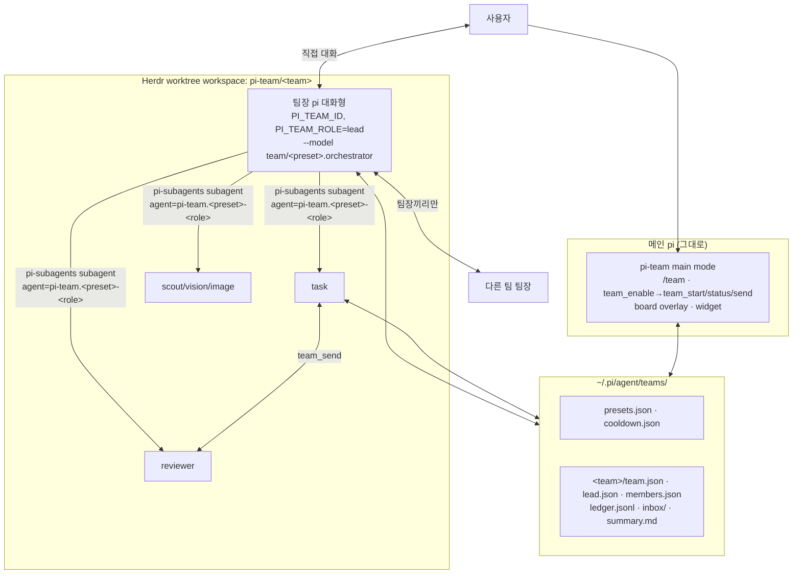

# pi-team 설계 v3 (확정)

- 확정일: 2026-11-25. 사용자 결정 D1~D8과 E1~E4, 추가 요청(overlay TUI)을 반영했습니다. v2 원문은 `DESIGN-v2.md`에 있습니다.
- 대상: pi 1.6.0과 pi-subagents 0.90.x. Mac Studio에서 anthropic과 openai-codex OAuth로 로그인되어 있습니다.

## 1. 확정 결정

| # | 결정 |
|---|---|
| D1 | 시작은 `/team` 명령으로 합니다. **사용자가 대화에서 명시적으로 요청한 경우** 메인 모델도 팀 도구로 시작할 수 있습니다. |
| D2/E1 | 팀장은 **독립된 대화형 pi 세션**입니다. Herdr 안이면 팀마다 `herdr worktree create`로 worktree workspace를 만들고 그 pane에서 실행합니다. 사용자는 팀장과 직접 대화합니다. |
| D3 | 팀 worktree는 HEAD(또는 `--base`)에서 branch `pi-team/<team>`으로 만듭니다. 끝나도 보존하고, 병합은 사용자가 결정합니다. `/team close`로 정리합니다. |
| D4 | 기본 preset `mix`는 v2 §4 표대로 둡니다(아래 §4). |
| D5 | 팀 사이 메시지는 **팀장끼리만** 주고받습니다. 팀원은 자기 팀 안에서만 보냅니다. |
| D6 | 메인의 pi-subagents(`subagents_enable`)는 그대로 둡니다. |
| D7 | image 역할에만 `pi-codex-image-gen@0.3.2`를 로드합니다. 메인에는 설치하지 않습니다. 검증에 실패하면 image 역할을 비활성화합니다. |
| D8 | 코드는 `~/workspace/development/pi-team`의 로컬 git 저장소에 둡니다. Mac Studio에서 `pi install <path>`로 연결합니다. |
| E2 | idle 상태의 팀장이 다른 팀장의 메시지를 받으면 바로 턴을 시작합니다. 작업 중이면 steer로 넣습니다. |
| E3 | 메인 모델도 팀장에게 메시지를 보낼 수 있습니다(`team_send`). 사용자는 `/team send`로 보냅니다. |
| E4 | Herdr 밖에서는 git worktree만 만들고 팀장 실행 명령을 안내합니다. 어느 pi 세션에서든 `/team board` overlay로 모든 팀, worktree, 팀 안의 동작을 볼 수 있습니다. |

## 2. P0 검증 결과 (실행 확인)

- 자식 세션 ID와 세션 파일은 자식마다 고유합니다.
- 자식 안에서 `pi.sendMessage(steer)`를 호출하면 그 자식 세션에만 들어갑니다.
- 자식에 등록한 virtual model은 자식 프로세스 안에서 `route()`를 거쳐 실제 모델로 전송됩니다.
- resume할 때 모델을 바꿀 수는 **없습니다**.
- 근거: `~/.cache/agent-work/.omp-9615d25fee/pi-mesh-p0/out/`

## 3. 구조



하나의 패키지(`pi-team`)가 세 모드로 동작합니다.

| 모드 | 판별 기준 | 역할 |
|---|---|---|
| main | `PI_TEAM_ROLE` 없음 | `/team` 명령, `team_enable` loader, board overlay·widget, 팀 생성·정리 |
| lead | `PI_TEAM_ROLE=lead`, `PI_TEAM_ID=<team>` | heartbeat, 팀원 snapshot, 팀장용 메시지 도구, 필수 child 확장 등록, `subagent` 호출 검사, 팀 보고 |
| member | 필수 child 확장(`child.ts`) | virtual model 등록, 팀 메시지 도구, 자기 등록, 부작용 추적, 오류 분류와 cooldown 기록 |

- virtual model(`team/<preset>.<role>`)은 **모든 모드에서** 등록합니다. preflight 단계와 자식 프로세스 모두 이 모델을 찾을 수 있어야 하기 때문입니다.

## 4. preset과 역할

- `~/.pi/agent/teams/presets.json`: 없으면 아래 기본값으로 만듭니다. 프로젝트 `.pi/teams/presets.json`에 같은 이름의 preset이 있으면 통째로 대체합니다.

  | 역할 | `mix` 후보 체인 | 속성 |
  |---|---|---|
  | orchestrator | `anthropic/claude-opus-5-5:high` → `openai-codex/gpt-6.2-sol:xhigh` | 팀장 세션 자체 모델 |
  | task | `openai-codex/gpt-6.2-sol:medium` → `anthropic/claude-opus-5-5:high` | max 3 |
  | scout | `openai-codex/gpt-6-luna:high` → `openai-codex/gpt-6.2-sol:medium` | readOnly |
  | reviewer | `openai-codex/gpt-6.2-sol:high` → `anthropic/claude-opus-5-5:high` | readOnly |
  | vision | `openai-codex/gpt-6.2-sol:high` → `anthropic/claude-opus-5-5:high` | readOnly, 이미지 경로를 `read` |
  | image | `openai-codex/gpt-6.2-sol:medium` | `codex_generate_image` 도구, 결과는 `<worktree>/artifacts/` |

- **역할 추가:** 사용자가 역할을 자유롭게 추가할 수 있습니다. 역할 속성은 `models`, `tools`, `extensions`, `readOnly`, `max`, `prompt`입니다.
- **역할 agent 생성:** 확장이 `~/.pi/agent/agents/pi-team/<preset>/<role>.md`를 생성합니다. frontmatter는 `package: pi-team`, `name: <preset>-<role>`, `model: team/<preset>.<role>`이고, readOnly 역할은 `excludeTools: write, edit`로 둡니다. orchestrator는 agent 파일을 만들지 않습니다.
- **virtual model 라우팅:**
  - `reason` 값이 `user` 또는 `continuation`이면, 인증이 있고 cooldown 중이 아닌 첫 후보를 고릅니다.
  - `retry`면 실패한 모델을 건너뜁니다.
  - 후보가 모두 막혔으면 cooldown이 가장 먼저 끝나는 후보를 고르고 경고를 남깁니다.
- **실패 분류(member):** `agent_end`/`agent_settled`의 최종 `stopReason:"error"`와 `errorMessage`를 다음 네 분류로 나눕니다.
  - `quota`: `insufficient_quota`, `usage limit`, `billing`, `quota`
  - `rate_limit`: 429, `rate limit`
  - `overloaded`: 529, 503, `overloaded`
  - `auth`: 401, 403
  - 분류가 정해지면 `cooldown.json`에 기록하고 ledger에 `fallback` 이벤트를 남깁니다.
  - `sideEffects`는 write·edit·bash를 한 번이라도 실행했으면 true입니다.
- **팀장 프롬프트 규칙:**
  - 실패한 팀원의 `sideEffects`가 false면 같은 역할을 다시 실행합니다. route가 cooldown 모델을 건너뛰므로 자동으로 다음 후보가 쓰입니다.
  - true면 다시 실행하지 않고 사용자에게 보고합니다.
- **`subagent` 호출 강제(lead):** `tool_call` hook으로 `subagent` 호출을 검사해 두 경우를 막습니다.
  - `model` 인자가 있는 호출
  - `pi-team.<현재 preset>-*`가 아닌 agent를 지정한 호출

## 5. 팀 생성·worktree·정리

1. `/team start <preset> [--name N] [--base REF] [--from-dirty] -- <목표>`, 또는 메인 모델의 `team_start`.
2. 이름을 검증합니다(`[a-z0-9-]{1,32}`, 중복 금지). 미커밋 변경이 있으면 `--from-dirty` 없이는 거부합니다.
3. worktree를 만듭니다.
   - **Herdr 안**(`HERDR_PANE_ID` 존재): `herdr worktree create --cwd <repo> --branch pi-team/<team> --base <ref> --label "pi-team <team>" --no-focus`를 실행하고, 출력에서 workspace ID, pane ID, 경로를 얻습니다. 출력 형식은 구현할 때 실제로 확인합니다.
   - **Herdr 밖:** `git worktree add -b pi-team/<team> <repoParent>/worktrees/<repo>/team-<team> <ref>`
4. `team.json`을 기록합니다.
5. 팀장을 실행합니다.
   - Herdr: `herdr pane run <pane> env PI_TEAM_ID=<team> PI_TEAM_ROLE=lead pi --model team/<preset>.orchestrator --append-system-prompt <teamdir>/lead-prompt.md "<목표>"`
   - 밖: 같은 명령을 화면에 안내합니다.
6. **정리:** `/team close <team>`은 다음 조건이 모두 충족될 때 진행합니다.
   - 팀장 프로세스가 종료되었거나 사용자가 확인함
   - 살아 있는 팀원이 없음
   - branch가 base에 병합되었거나 사용자가 확인함

   진행 순서는 `summary.md`와 ledger를 `teams/archive/<team>/`로 옮긴 뒤, Herdr이면 `herdr worktree remove --workspace <id>`, 아니면 `git worktree remove`를 실행합니다. 병합되지 않은 branch는 지우지 않습니다.

## 6. 메시징

- **저장소:** `~/.pi/agent/teams/<team>/inbox/<addr>/<ulid>.json`이며, tmp 파일에 쓴 뒤 rename하고 모드는 0600입니다. 팀장끼리 주고받는 메시지는 수신 팀의 `inbox/lead/`에 들어갑니다.
- **주소 규칙:**
  - 팀원 → 같은 팀의 `lead`, `<role>-<n>`, `*`(팀 안 전체)
  - 팀장 → 자기 팀원, `lead@<다른 팀>`, `lead@*`
  - 메인(`team_send`, `/team send`) → `lead@<team>`
  - 그 밖의 경로는 거부합니다.
- **형식:** `{v,id,team,from,to,replyTo?,subject?,body≤4KiB,refs?,hops,sentAt}`. `fyi`/`action` 같은 종류 구분은 없습니다.
- **상태:** `sent` → `delivered` → `replied`/`closed`, 또는 `undelivered`. 상태 변화는 `ledger.jsonl`에 append-only로 기록합니다.
- **수신:**
  - 수신 쪽 확장이 `fs.watch`(1초 polling 보조)로 감시합니다.
  - 작업 중이면 `sendMessage(…, {deliverAs:"steer"})`로 넣습니다.
  - idle 팀장은 `triggerTurn:true`로 바로 턴을 시작합니다(E2). idle 팀원은 다음 턴에 받습니다.
- **도구:** `team_peers`, `team_send`, `team_inbox`, `team_wait(≤120s)`.
- **제한:**
  - hop 5회
  - 송신자당 분당 20건
  - 팀 전체 500건
  - 같은 팀의 살아 있는 구성원이 모두 `team_wait` 상태이면 5초 뒤 대기를 해제하고 교착 알림을 보냅니다.

## 7. 상태판

- **widget**(팀이 있을 때만 한 줄): `teams: A ▶ 4/5 ✉3 · B ✓ done (+120 -14)`
- **`/team board` overlay**(모든 모드에서 사용 가능, 레지스트리 파일만 읽음, 열려 있는 동안 2초마다 갱신):
  1. **Teams 화면:** 이름, preset, 상태(lead heartbeat로 판정, 10초 동안 없으면 `stale`), 저장소, worktree 경로, branch, 위치(Herdr workspace 또는 `external`), diff stat, 멤버 수, 메시지 수.
  2. **Team 화면:** 각 구성원의 역할, member key, 실제 모델(fallback이면 `⇢`), 상태, 현재 도구와 경로, 메시지 S/R, 토큰. 아래에 최근 메시지 5개를 보여 줍니다.
  3. **Messages 화면:** ledger를 스레드 단위로 보여 줍니다(`replyTo`로 묶음).
  4. **Summary 화면:** `summary.md`를 보여 줍니다.
- **키:** `↑↓`/`Enter`로 이동, `Tab`으로 화면 전환, `s`로 팀장에게 보내기, `Esc`로 닫기.
- **데이터 출처:**
  - `team.json`(정적 정보)
  - `lead.json`(팀장 heartbeat: pid, sessionId, state, 현재 활동, 실제 모델)
  - `members.json`(팀장이 2초마다 pi-subagents RPC `status`에서 만든 snapshot과 member 자기 등록 정보를 합친 것)
  - `ledger.jsonl`

## 8. 결과 취합

- 팀장의 `team_report({summary, status})` 도구, 또는 팀장이 `/team done`을 실행하면 `summary.md`를 만듭니다. 내용은 다음과 같습니다.
  - 역할별 결과와 실제 모델
  - 메시지 스레드의 결론과 답장을 받지 못한 질문
  - diff stat
  - fallback·cooldown 이력
  - 충돌 후보
- 메인에서 조회하는 방법은 둘입니다.
  - 메인 모델: `team_status`
  - 사용자: `/team collect <team>`. 요약을 `nextTurn` 메시지로 넣으며, 이때 메인 모델은 실행되지 않습니다.

## 9. 트리거와 휴면(main)

- **팀이 없을 때 메인에 보이는 것:**
  - `/team` 명령
  - virtual model 목록
  - loader 도구 `team_enable` 하나가 보입니다. 사용자가 팀 생성·관리를 명시적으로 요청하거나 설정된 이름의 팀에 위임을 요청할 때만 호출합니다. 호출하면 `team_start`, `team_status`, `team_send`, `team_delegate`를 활성화합니다.
- **팀이 없을 때 하지 않는 것:** 파일 감시, polling, widget 표시.

### 별칭

- 전역 `~/.pi/agent/teams/aliases.json`과 프로젝트 `.pi/teams/aliases.json`에서 이름을 정합니다. 키가 같으면 프로젝트 항목이 전역 항목을 통째로 대체합니다. 파일이 없으면 빈 설정으로 처리합니다.
  ```json
  {
    "graphics": {
      "preset": "mix",
      "names": ["그래픽", "그래픽 팀", "디자인"],
      "description": "UI 시안·이미지·시각 검토"
    }
  }
  ```
- 이름을 소문자로 바꾸고 공백과 끝의 `팀`·`team`을 제거합니다. 키, 별칭 이름, preset 이름 순으로 찾습니다. 별칭에 서로 겹치는 이름을 붙이거나 존재하지 않는 preset을 지정하면 설정 오류가 납니다. 필요하면 `base`로 시작 기준 ref를 지정합니다.
- 메인 세션에 「그래픽 팀에게 작업을 위임해 줘」라고 요청하거나 `/team delegate 그래픽 팀 -- <작업>`을 실행합니다. 같은 별칭을 기록한 미보관 팀 중 가장 최근 팀이 있으면 그 팀장의 inbox에 작업을 보냅니다. 팀장이 실행 중이 아니어도 메시지는 inbox에 남습니다. 팀이 없으면 해당 preset으로 시작합니다.
- `/team alias show`에서 preset과 현재 팀의 상태를 확인합니다. `/team start <별칭>`은 기존 팀을 재사용하지 않고 새 팀을 만듭니다. 별칭 키를 팀 ID로 사용하되 이미 쓰인 ID·아카이브·브랜치는 `-2`, `-3`을 붙여 피합니다. `--name`을 지정하면 그 값을 우선합니다.

## 10. 수용 기준

| # | 기준 |
|---|---|
| A1 | `/team preset show`가 역할별 체인과 인증, cooldown을 보여 줍니다. cooldown을 주입하면 다음 후보로 응답합니다(세션 기록의 provider/model로 확인). |
| A2 | Herdr 밖: `/team start mix --name t1 -- <목표>`가 worktree와 branch를 만들고 실행 명령을 안내합니다. 그 명령으로 띄운 팀장이 task와 reviewer를 위임하고, 둘 다 worktree 안에서 동작합니다. 메인 모델과 도구는 바뀌지 않습니다. |
| A3 | 팀원 task ↔ reviewer 사이에 질문과 답장이 오가고 `replied`로 기록됩니다. 다른 팀 팀원에게 보내면 거부됩니다. |
| A4 | 팀장 둘이 `lead@` 메시지를 주고받습니다. idle 팀장이 자동으로 턴을 시작합니다. |
| A5 | `/team board`가 두 팀, worktree, 구성원별 모델·상태·현재 도구, 메시지를 2초 안에 갱신해 보여 줍니다(Herdr 밖 overlay). |
| A6 | Herdr 안: `/team start`가 worktree workspace를 만들고 팀장을 실행합니다. `/team close`가 workspace와 worktree를 정리하고, 병합되지 않은 branch는 남깁니다. |
| A7 | image 역할이 `artifacts/`에 PNG를 만듭니다(OAuth). 실패하면 원인을 기록하고 역할을 비활성화합니다. vision 역할이 PNG를 읽고 설명합니다. |
| A8 | `team_enable`을 호출하기 전에는 메인 모델 도구 목록에 `team_start` 등이 없습니다. |
